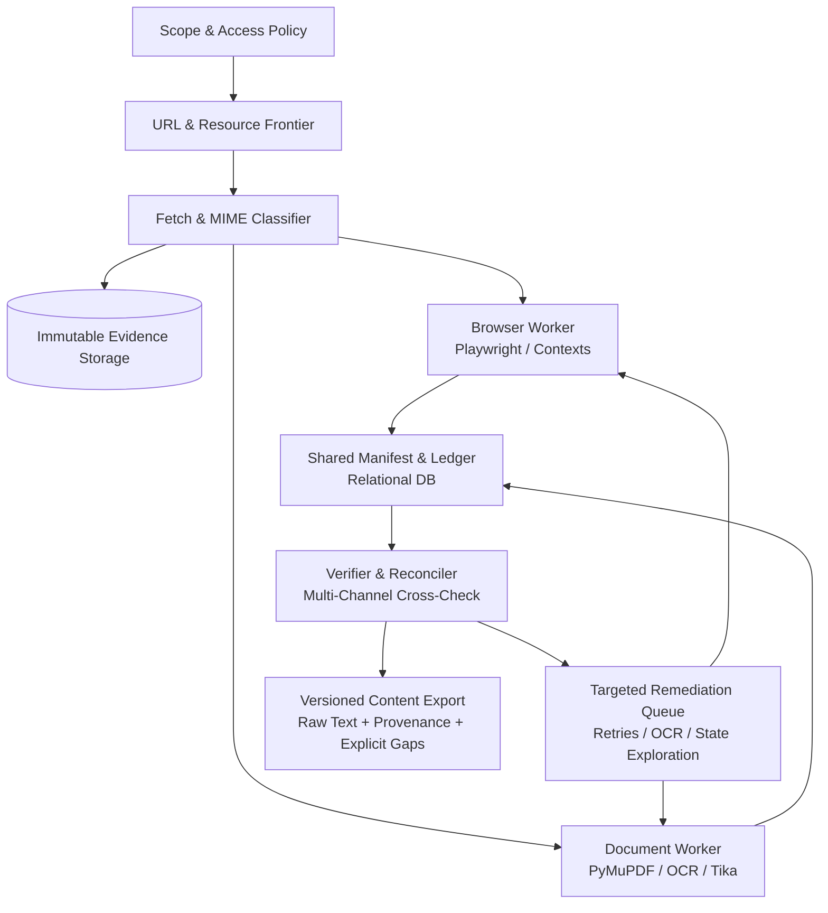

# Content Processor: Evidence-Backed Content Extraction & Completeness Verification

An evidence-backed web and document content extraction system engineered to **expose gaps and verify completeness**, rather than acting as a traditional scraper making unverified 100% coverage claims.

This repository hosts the foundational research, architecture designs, test inventories, and technical audits for building a trustworthy content extraction platform. The system pairs multi-channel capture (raw HTTP, rendered browser states, accessibility trees, and visual OCR) with an immutable ledger of resources, states, and regions to make omissions explicit.

---

## Table of Contents

- [Core Philosophy](#core-philosophy)
- [Why Traditional Scrapers Fail](#why-traditional-scrapers-fail)
- [System Architecture](#system-architecture)
  - [Processing Pipeline](#processing-pipeline)
  - [The Manifest & Ledger Model](#the-manifest--ledger-model)
  - [Multi-Channel Capture Strategy](#multi-channel-capture-strategy)
- [Honest Completeness Metrics & Status Precedence](#honest-completeness-metrics--status-precedence)
- [The 83-Case Failure & Validation Inventory](#the-83-case-failure--validation-inventory)
- [Implementation Roadmap](#implementation-roadmap)
- [Downstream Analysis & Contradiction Detection](#downstream-analysis--contradiction-detection)
- [Repository Structure & Documentation Index](#repository-structure--documentation-index)

---

## Core Philosophy

> [!IMPORTANT]
> **The right product is an evidence-backed extraction system that reports missing content, not a scraper that promises unconditional 100% coverage.**

When capturing public third-party web pages and complex documents:
1. **No universal crawl can capture all possible visitor experiences:** Web content varies across viewports, locales, time, user interactions, and access conditions.
2. **Denominators must include failures:** Completeness cannot be computed solely from successfully parsed items or by removing failures from the denominator.
3. **Gaps must be preserved as first-class evidence:** An extracted page with an unrendered footnote, a blocked iframe, or an unvisited tab must yield a `PARTIAL` status with explicit gap metadata rather than a misleading `100% COMPLETE` score.
4. **Verified within declared scope:** Results are defended as *“verified within this declared scope and capture context,”* backed by immutable evidence, exact coordinates, and transparent uncertainty.

---

## Why Traditional Scrapers Fail

| Flawed Scraper Assumption | Real-World Failure Mode | Evidence-Driven Design Countermeasure |
|---|---|---|
| **`networkidle` / static sleep indicates completion** | Client SPAs, WebSockets, or hydration continue loading data after network lulls. Early clicks fail. | Continuous delta monitoring within a bounded stability window; explicit stop reasons. |
| **Scrolling to bottom captures all items** | Virtualized lists (`react-window`, infinite grids) recycle DOM nodes; earlier elements are removed. | Incremental ledger accumulation during multi-axis traversal before DOM recycling occurs. |
| **Page has text, so no OCR is needed** | Mixed PDFs contain native digital headers alongside scanned body clauses or stamped disclaimers. | Region-level inspection: native text never suppresses OCR over detected visual text blocks. |
| **`HTTP 200` equals successful capture** | Anti-bot mechanisms and Cloudflare challenge pages return HTTP 200 with HTML CAPTCHA payloads. | Payload signature, MIME validation, and challenge detection (`cf-mitigated: challenge`). |
| **Weighted 98% complete score** | 98% word count or node ratio hides a missing 2-line pricing exclusion or legal clause. | Elimination of masking averages; separate status vectors for discovery, acquisition, and fidelity. |

---

## System Architecture

### Processing Pipeline



### The Manifest & Ledger Model

Every run tracks seven interconnected ledger entities:

- **Run:** Scope hash, tool/model versions, resource/time budgets, inventory revision, closure state, and termination reason.
- **Resource:** Parent relationships, original/final URLs, redirect chains, MIME verification, status, payload hash, and mandatory flags.
- **State:** UI action history, viewport, locale, access context, capture timestamp, DOM fingerprint, and remaining unexplored controls.
- **Region:** Specific DOM selector, bounding box, frame path, or PDF coordinates; visibility classification, expected extraction method, and status.
- **Extraction:** Raw and normalized text, reading order, coordinates, confidence scores, competing hypotheses, and normalization rules.
- **Evidence:** Cryptographic hashes, immutable object storage pointers, redaction flags, and relationships to captured entities.
- **Event:** Append-only sequence tracking state changes, inventory revisions, retries, and remediation attempts.

### Multi-Channel Capture Strategy

Rather than relying on a single HTML snapshot or DOM dump, extraction is reconciled across distinct observation channels:
1. **Raw Response Bytes & Headers:** Preserves exact server-delivered payloads and MIME signatures.
2. **Rendered Browser DOM:** Traverses composed slots and open shadow DOM using browser automation contexts.
3. **Accessibility Semantic Tree (ARIA snapshots):** Extracts roles, names, and structured values as presented to assistive tools.
4. **Visual Layout & Region OCR:** Captures screenshots, detects text-shaped visual blocks, and executes targeted OCR on raster images, canvas, and styled elements.
5. **Network Responses & Metadata:** Records JSON-LD, microdata, and client-side REST/hydration payloads without asserting unrendered script strings as published text.

---

## Honest Completeness Metrics & Status Precedence

Completeness is decomposed into independent, mathematically defensible dimensions:

$$\text{Inventory Accounting} = \frac{\text{Terminal Manifest Items}}{\text{Discovered In-Scope Manifest Items}}$$

$$\text{Acquisition Coverage} = \frac{\text{Successfully Acquired Required Resources}}{\text{All Discovered Required Resources (including blocked/failed)}}$$

$$\text{Region Verification Coverage} = \frac{\text{Verified Required Content Regions}}{\text{All Discovered Required Content Regions}}$$

$$\text{Fidelity Evaluation} = \frac{\text{Matched Ground-Truth Tokens / Clauses}}{\text{Total Ground-Truth Tokens / Clauses}}\quad (\text{on annotated fixtures})$$

### Status Badge Precedence

When a single operational badge is required, it follows strict precedence without masking underlying gap vectors:

```
[RUNNING] ──► Work or bounded discovery still executing
[FAILED]  ──► No usable target payload obtained due to acquisition or parser crash
[BLOCKED] ──► Explicit access restriction (auth, geo-block, CAPTCHA) prevents retrieval
[PARTIAL] ──► Target content exists, but >=1 required resource, region, or state is missing/unsupported/budget-exhausted
[NEEDS_REVIEW] ──► Content obtained, but multi-channel fidelity or discovery verification remains unresolved
[VERIFIED_WITHIN_SCOPE] ──► Declared discovery closed and every required validation check passed
[EXCLUDED] ──► Explicit policy excluded target; never recorded as an extraction success
```

---

## The 83-Case Failure & Validation Inventory

The architecture is validated against an 83-case engineering test matrix consolidated in the primary investigation report:

### 1. HTML & Browser Dynamics (Cases 01–40)
- **State & Loading:** Malformed markup, SSR hydration, client SPAs, WebSockets/long-polling, delayed fetch.
- **Dynamic Content & Layout:** Lazy images/sections, nested overflow containers, infinite scroll, virtualized lists and 2D grid columns.
- **Interactions:** Accordions, tabs, carousels, hover menus, informational modals, pagination, product/plan selectors.
- **Encapsulation:** Declarative/open shadow DOM, closed shadow roots, nested cross-origin and `srcdoc` iframes.
- **Visual & CSS Elements:** CSS pseudo-elements (`::before`/`::after`), CSS background sprites, `<canvas>`/WebGL, SVG text and glyph paths.
- **Environment & Occlusion:** Viewport/device responsiveness, locale/currency/timezone variants, sticky consent overlays, and A/B test variations.

### 2. Documents, Media & OCR (Cases 41–65)
- **PDF Complexities:** Marginalia/headers/footers, scanned pages, mixed native/scanned pages, stale/partial existing OCR layers, broken font encodings, and vector-drawn text.
- **Layout & Structure:** Multi-column layouts, rotated/vertical text, RTL/CJK scripts, merged/multipage tables, and embedded charts/diagrams.
- **Document Internals:** PDF forms/XFA, annotations/popups, file attachments/portfolios, and optional content layers.
- **Office Formats:** Word (DOCX package parts, comments, revisions), PowerPoint (PPTX notes, masters, hidden slides), Excel (XLSX formulas, hidden sheets), and compressed archive packages (EPUB/ZIP).
- **Audio & Video:** Audio transcripts (ASR uncertainty/hallucinations), video text overlays, and multi-track audio.

### 3. Access, Scope, Security & Operations (Cases 66–83)
- **Network & Access:** Redirect chains/loops, rate-limiting (HTTP 429 & `Retry-After`), transient 5xx backoff, HTTP 200 challenge pages, soft 404s, and expired signed URLs.
- **Discovery Boundaries:** Faceted navigation URL explosion, CDN asset scoping, and RFC 9309 robots handling.
- **Operational Security:** Worker sandboxing, memory/pixel/decompression limits (archive bombs), and SSRF prevention on seeds, redirects, and frame sources.
- **Fidelity Retention:** Preserving exact numbers, currencies, units, negations, and footnote relationships during normalization.

---

## Implementation Roadmap

```mermaid
gantt
    title Implementation Stages & Release Gates
    dateFormat  X
    axisFormat  Stage %s
    
    section Foundation
    Stage 0: Contract, Ledger Schema & Benchmarks  :0, 1
    Stage 1: Audited Capture MVP (HTML, PDF, Region OCR) :1, 2
    
    section Expansion
    Stage 2: Dynamic Coverage (Tabs, Virtualization, Frames, Live Gaps) :2, 3
    Stage 3: Format Breadth (Office Packages, Media, Archives) :3, 4
    
    section Downstream Analysis
    Stage 4: Website Theming, Similarity & Contradiction Analysis :4, 5
```

- **Stage 0: Contract and Benchmark:** Finalize scope schemas, SQLite/PostgreSQL ledger tables, annotated evaluation fixtures, and baseline error benchmarks.
  - *Exit Criterion:* Every capability and exclusion has an automated test with an inspectable outcome.
- **Stage 1: Audited Capture MVP:** Core workers for raw HTML, rendered browser DOM, native PDF inspection, and region OCR with immutable storage.
  - *Exit Criterion:* Every supplied URL yields an auditable outcome; all blocks have verifiable provenance.
- **Stage 2: Dynamic Coverage:** Interactive state exploration (tabs, accordions, nested scrollers, virtualization) with streaming gap events.
  - *Exit Criterion:* **Release Gate:** Zero false `VERIFIED_WITHIN_SCOPE` certifications across the adversarial test suite.
- **Stage 3: Broader Format Fidelity:** Full support for Office packages (DOCX, PPTX, XLSX), archives, and media tracks.
  - *Exit Criterion:* Per-feature validation; unsupported elements remain explicit gaps.
- **Stage 4: Website Analysis:** Semantic similarity, topic theming, and multi-claim contradiction analysis.
  - *Exit Criterion:* Downstream analysis explicitly ingests gap metadata and discounts uncertain or OCR-degraded regions.

---

## Downstream Analysis & Contradiction Detection

High-level website analysis (theming, clustering, semantic comparisons, and contradiction detection) fails if built on unchecked scraper output.

```
┌────────────────────────────────────────────────────────┐
│               Contradiction Candidate Pair             │
├──────────────────────────┬─────────────────────────────┤
│ Claim A:                 │ Claim B:                    │
│ "Free shipping on orders │ "Shipping fees apply to all │
│ over $50"                │ regional orders"            │
│                          │                             │
│ Provenance:              │ Provenance:                 │
│ Banner Text (DOM)        │ Terms Footnote (Image OCR)  │
│ State: Default View      │ State: Expanded Modal       │
│ Evidence: #dom-snap-01   │ Evidence: #img-crop-04      │
│ Status: VERIFIED         │ Status: NEEDS_REVIEW        │
└──────────────────────────┴─────────────────────────────┘
                             │
                             ▼
         [Contradiction Verifier & Audit Ledger]
         Requires exact context alignment (Date,
         Product Variant, Locale, and Capture Status)
```

1. **Context Alignment Before Comparison:** Apparent contradictions are frequently artifacts of different capture dates, regional locales, user tiers, or A/B test variants.
2. **Evidentiary Hierarchy:** Visually confirmed, high-confidence DOM text carries higher evidentiary weight than speculative OCR on degraded banners or hidden CMS strings.
3. **Gap-Aware Confidence:** If a pricing page has unvisited tabs or an unread image disclaimer, contradiction algorithms flag the output with reduced confidence rather than asserting definitive conclusions.

---

## Repository Structure & Documentation Index

```
content-processor/
├── README.md                                                   # Project overview & architectural guide (this file)
├── pyproject.toml · .env.example · scripts/verify.ps1          # Rankuno SDLC tooling (ruff, mypy strict, pytest ≥85% coverage)
├── src/
│   ├── core/                                                   # Vendored Rankuno core (StrictModel, BaseTool, CostLedger, guardrails, logger)
│   └── modules/content_processor/                              # Stage 0 scaffold
│       ├── enums.py · contracts.py                             # Two-level status taxonomy, RunScope with policy validators, ledger contracts
│       ├── scope/  (normalize, ssrf, frontier)                 # Schedule keys, egress classification, deduplicated fetch plan
│       ├── governor/ (block_classifier, escalation)            # Vendor block signatures, per-host circuit breaker + tier escalation
│       ├── verify/status.py                                    # Badge derivation by precedence; status vector
│       ├── ledger/ (schema.sql, sql.py, tasks.py, keys.py)     # Postgres task ledger: SKIP LOCKED leases, host slots, reaper, events
│       └── planner.py                                          # Frontier → FETCH tasks with idempotency keys
├── fixtures/                                                   # Local adversarial fixture server (server.py), manifest.json, pages/, seeds/
├── tests/                                                      # Mirrors src/; ledger integration + chaos tests need CP_DATABASE_URL
├── docs/
│   ├── ARCHITECTURE.md                                         # SDLC Step 2: system architecture for 5,000+ URL runs (topology, task ledger, host governor, contracts, capacity, failure modes, staged plan)
│   ├── ACCESS_RESILIENCE_PLAYBOOK.md                           # Access tiers T0–T6, block classifier, escalation state machine, Bright Data credit caps, legal gate
│   ├── STAGE4_ANALYSIS_AND_INTERFACES.md                       # Backlog: theming, similarity, contradiction mechanisms + the four review interfaces and reports (R1–R4)
│   └── adr/                                                    # 0001 task ledger · 0002 browser worker · 0003 extraction routes · 0004 access ladder · 0005 status taxonomy
├── reports/
│   ├── Content extraction completeness investigation.md        # Primary architectural investigation & 83-case matrix
│   └── Gap audit and extended edge-case inventory.md           # Problem-statement audit, unified-investigation defects, cases 91–214, corrected taxonomies, decision register
└── research_notes/
    ├── Consolidated extraction investigation pathway/
    │   ├── pathway.md                                          # Ordered 8-workstream research methodology & decision register
    │   ├── comparison.md                                       # Cross-investigation analysis & critique of 98% complete models
    │   └── technical-audit.md                                  # Technical audit of browser, iframe, and OCR edge-case remediations
    └── Content extraction completeness investigation/
        ├── browser.md                                          # Deep dive into DOM, frames, shadow roots, and dynamic state capture
        ├── media.md                                            # Deep dive into PDF structures, mixed pages, OCR, and Office formats
        └── verification.md                                     # Manifest schemas, audit loop, status vectors, and operational security
```

### Key Reference Documents

- **[System Architecture (SDLC Step 2)](file:///c:/Users/RankUno/Desktop/content-processor/docs/ARCHITECTURE.md):** Topology, Postgres task ledger with leases and reaper, host governor, backpressure, Pydantic contracts, verification rules R1–R13, security isolation, 5,000-URL capacity plan, failure-mode catalogue, staged build plan with exit criteria.
- **[Access Resilience Playbook](file:///c:/Users/RankUno/Desktop/content-processor/docs/ACCESS_RESILIENCE_PLAYBOOK.md):** Authorization model, access tiers T0–T6, per-host escalation state machine, vendor block-signature table, shadow-block detection, identity-consistency checklist, legal gate.
- **[Gap Audit and Extended Edge-Case Inventory](file:///c:/Users/RankUno/Desktop/content-processor/reports/Gap%20audit%20and%20extended%20edge-case%20inventory.md):** Problem-statement audit, 22 defects in the unified investigation, 124 additional cases (91–214), corrected status/gap/layer/tier taxonomies, decision register.
- **[Primary Architectural Investigation](file:///c:/Users/RankUno/Desktop/content-processor/reports/Content%20extraction%20completeness%20investigation.md):** Complete review of content boundary contracts, the 83-case test matrix, ledger data structures, and phased engineering milestones.
- **[Research Pathway & Decision Register](file:///c:/Users/RankUno/Desktop/content-processor/research_notes/Consolidated%20extraction%20investigation%20pathway/pathway.md):** 8 ordered research workstreams, experimental controls, and the unresolved requirement register.
- **[Comparative Analysis](file:///c:/Users/RankUno/Desktop/content-processor/research_notes/Consolidated%20extraction%20investigation%20pathway/comparison.md):** Detailed comparison between competing completeness paradigms, explaining why weighted arbitrary scores (e.g. 98%) fail.
- **[Technical Audit](file:///c:/Users/RankUno/Desktop/content-processor/research_notes/Consolidated%20extraction%20investigation%20pathway/technical-audit.md):** Deep audit of browser locators, iframe contexts, service-worker behavior, and OCR limitations.
- **[Browser & HTML Deep Dive](file:///c:/Users/RankUno/Desktop/content-processor/research_notes/Content%20extraction%20completeness%20investigation/browser.md):** Examination of DOM hydration, multi-axis scrolling, shadow DOM, and ARIA snapshots.
- **[Media & Document Deep Dive](file:///c:/Users/RankUno/Desktop/content-processor/research_notes/Content%20extraction%20completeness%20investigation/media.md):** Detailed inspection of native vs. scanned PDF layers, form fields, vector text, and presentation internals.
- **[Verification & Operational Crawler Mechanics](file:///c:/Users/RankUno/Desktop/content-processor/research_notes/Content%20extraction%20completeness%20investigation/verification.md):** Specifications for the live audit loop, manifest schema, RFC 9309 robots policy, and SSRF sandboxing.
